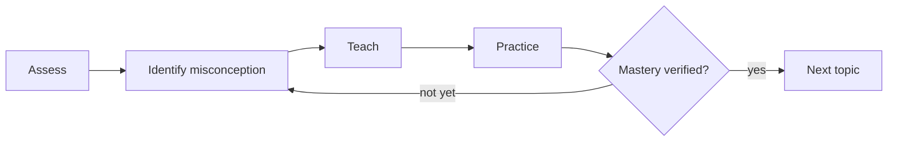

# MindMate: Your Personal AI Programming Tutor

[](https://github.com/Incarnate-Jayatu/MindMate/actions/workflows/ci.yml)

MindMate helps college students learn C++ and Data Structures & Algorithms by finding **why** they get things wrong, not just whether they did. Instead of handing everyone the same content, it diagnoses each learner's misconceptions, teaches around them, and checks that the understanding is real.



## Features

| Feature | How it works |
|---|---|
| **Skill diagnosis** | A short quiz covers each concept and sets the starting knowledge map. |
| **Misconception detection** | Every wrong option maps to a named misunderstanding (e.g. `arr-off-by-one`, `rec-no-base`). 28 are tracked today. |
| **Adaptive tutor** | A wrong answer gets a short explanation aimed at the diagnosed misconception. Uses an LLM when an API key is set, and a built-in fallback otherwise. |
| **Adaptive practice** | The next question comes from the weakest concept (weak prerequisites first), with difficulty matched to the learner's score. |
| **Mastery verification** | "Mastered" needs a score of at least 75% **and** at least 3 *different* questions answered correctly. Repeating one question cannot fake it. |
| **Endless fresh questions** | When the bank runs out, new variants are generated from templates with computed answers (no AI needed). |
| **Knowledge map** | A prerequisite graph colored by status, a "learn next" recommendation, and a misconception history. |

**Current topics:** C++ arrays, loops, recursion, strings, stacks, queues and linked lists (51 hand-written questions plus generated variants). Prerequisites: strings, stacks and linked lists build on arrays, queues build on stacks, recursion builds on loops.

## Tech stack

- **Frontend:** React, Vite, Tailwind CSS
- **Backend:** Python, FastAPI, SQLAlchemy
- **Database:** SQLite locally, PostgreSQL (e.g. Supabase) in production
- **AI (optional):** Groq (Llama 3.3) or Anthropic Claude for personalized explanations

## Project structure

```
mindmate/
├── backend/
│   ├── app/
│   │   ├── main.py       # API endpoints
│   │   ├── models.py     # database tables
│   │   ├── seed.py       # concepts, misconceptions, question bank
│   │   ├── mastery.py    # scoring and mastery rules
│   │   ├── practice.py   # next-question selection
│   │   ├── variants.py   # question generator (21 templates)
│   │   └── tutor.py      # LLM explanations with fallback
│   ├── tools/            # verify_answers.py: checks answers with a real C++ compiler
│   └── tests/
├── frontend/
│   └── src/              # App.jsx (quiz, practice), KnowledgeMap.jsx
└── .github/workflows/ci.yml
```

## Getting started

**Requirements:** Python 3.12+ and Node.js 18+.

Open two terminals.

```bash
# Terminal 1: backend  (API docs at http://127.0.0.1:8000/docs)
cd backend
pip install -r requirements.txt
uvicorn app.main:app --reload
```

```bash
# Terminal 2: frontend  (app at http://localhost:5173)
cd frontend
npm install
npm run dev
```

The database file and starter questions are created automatically on first run.

### Optional: AI tutor

Without a key, wrong answers get a simple built-in explanation. For AI explanations:

1. Create a free API key at [console.groq.com/keys](https://console.groq.com/keys).
2. Copy `backend/.env.example` to `backend/.env` and set `GROQ_API_KEY=your-key`.
3. Restart the backend.

Anthropic also works: set `ANTHROPIC_API_KEY` instead. If both are set, Groq is used.

**Keep keys secret.** Never put a key in code or commit `.env` (it is already in `.gitignore`). On a host like Render, add the key as an environment variable in the dashboard. CI fails the build if a key-like string is found in the repo.

## Configuration

| Variable | Where | Purpose |
|---|---|---|
| `DATABASE_URL` | backend | Database address. Defaults to local SQLite. Postgres URLs work as given. |
| `GROQ_API_KEY` | backend | Enables AI explanations via Groq (optional). |
| `GROQ_MODEL` | backend | Model override (default `llama-3.3-70b-versatile`). |
| `ANTHROPIC_API_KEY` | backend | Alternative AI provider (optional). |
| `CORS_ORIGINS` | backend | Comma-separated frontend addresses allowed to call the API in production. |
| `VITE_API_URL` | frontend | Backend address (default `http://127.0.0.1:8000`). Set at build time. |

## API overview

| Method | Endpoint | Purpose |
|---|---|---|
| POST | `/users` | Create a learner |
| GET | `/concepts` | List concepts and prerequisites |
| GET | `/diagnostic` | One question per concept |
| GET | `/questions?concept_id=` | All questions for a concept |
| POST | `/attempts` | Grade an answer, detect the misconception, update mastery |
| POST | `/tutor/explain` | Explanation for a wrong answer |
| GET | `/practice/next?user_id=&concept_id=` | Next adaptive question (concept optional) |
| GET | `/map/{user_id}` | Per-concept score and status |
| GET | `/insights/{user_id}` | "Learn next" recommendation and misconception history |
| GET | `/health` | Health check |

Interactive docs are served at `/docs`.

## How mastery works

- Each concept starts at a score of 0.5. Every answer moves it: `score = 0.7 × score + 0.3 × (1 if correct else 0)`.
- Status is `weak` (below 40%), `learning`, or `mastered` (at least 75% and at least 3 distinct correct questions).
- Generated variants have computed answers. Every stored answer and template was cross-checked by compiling and running the C++ with `g++` (191 programs, no mismatches).

## Testing

```bash
cd backend && pytest
cd frontend && npm run build
cd backend && python tools/verify_answers.py   # optional, needs g++
```

GitHub Actions runs both on every push.

## Deployment

- **Database:** Supabase (use the *Session pooler* connection string).
- **Backend:** Render web service. Root directory `backend`, build `pip install -r requirements.txt`, start `uvicorn app.main:app --host 0.0.0.0 --port $PORT`. Set `DATABASE_URL`, and optionally `GROQ_API_KEY`.
- **Frontend:** Vercel. Root directory `frontend`, and set `VITE_API_URL` to the Render address. Then add the Vercel address to `CORS_ORIGINS` on Render.

## Roadmap

- [ ] More concepts: functions, searching, sorting, trees, hash maps
- [ ] Write-the-code questions graded by a sandboxed C++ runner
- [ ] User accounts and saved progress across devices
- [ ] Spaced repetition for mastered concepts
- [ ] AI-generated question variants, validated by code execution

## Author
 - Jayatu ([@Incarnate-Jayatu](https://github.com/Incarnate-Jayatu)).
 - Manali ([@Manali0128](https://github.com/Manali0128)).
 - Asmi ([@asmideshpande307-commits]((https://github.com/asmideshpande307-commits))).
